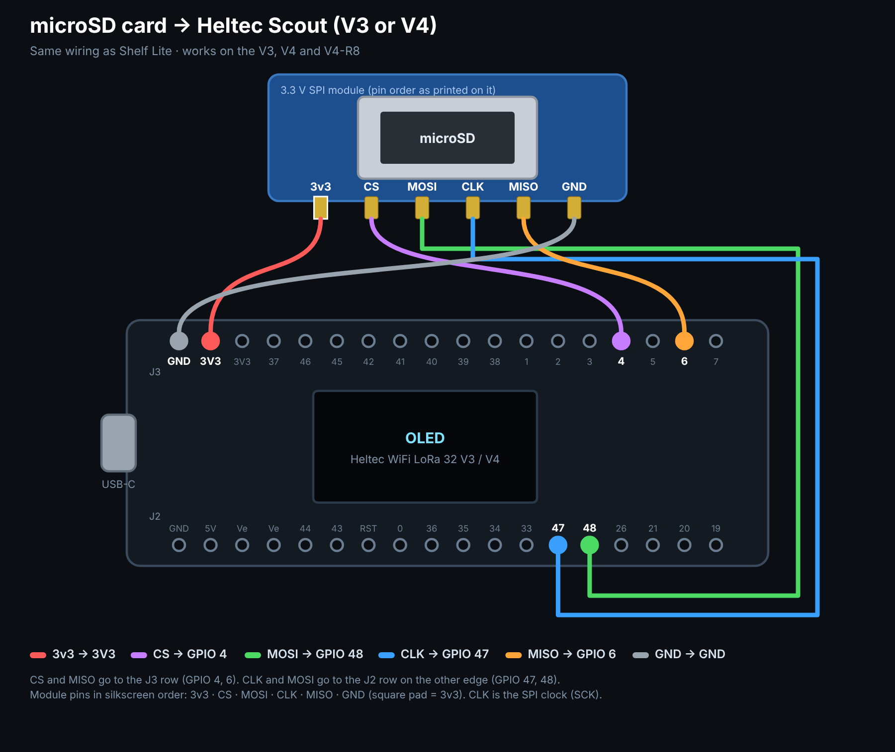

# Heltec Scout

A **Wi-Fi thumb drive** that also **logs everything it hears** — Wi-Fi networks, Bluetooth devices, LoRa / Meshtastic packets and any other activity in the 900 MHz band — to a microSD card, for the **Heltec WiFi LoRa 32 V3 and V4**.

**Scout Studio** (the web page in `docs/`) installs the firmware, pulls the logs off the board over USB (or from the card / a downloaded file), and analyzes and maps them.

### ➡️ Install and analyze from your browser: **https://hardwaremack-prog.github.io/Heltec-Scout/**

> Installing Scout replaces Meshtastic on that board. You can put Meshtastic back any time from [flasher.meshtastic.org](https://flasher.meshtastic.org).

## What it does

| Screen | Shows | Logged to |
|---|---|---|
| **Drive** | Hotspot name, address, people connected, card space, session, clock, GPS | `events.csv`, `gps.csv` |
| **Wi-Fi** | Networks now / seen, strongest four with channel | `wifi.csv` (every scan, every 20 s) |
| **Bluetooth** | Devices now / seen, strongest four with type (FindMy, Tile, Samsung…) | `ble.csv` (one line per device per 15 s) |
| **LoRa** | Packets, nodes, last three senders with signal | `lora.csv` (full packet + Meshtastic header) |
| **900 MHz** | Live spectrum 902–928 MHz with peak hold, busiest frequency | `rf900.csv` (every hit + a full sweep each minute) |

The screens **scroll on their own** (6 s each, changeable). Everything logs the whole time, whatever is on screen.

### Buttons

| Press | Does |
|---|---|
| **PRG** once | Screen sleep / wake (logging keeps going) |
| **PRG** twice quickly | Next screen |
| **PRG** held 3 s | Asks *Reboot?* — press **PRG** once to reboot (logs kept). Goes back by itself after 8 s. |
| **RST** | Instant restart. It's wired straight to the chip's reset line, so software can't see it being pressed or held. That's why sleep and the reboot prompt live on PRG. |

### Thumb drive

Join **Scout-XXXX** (password `heltecscout`). The page pops up, or open `http://192.168.4.1` (also `http://scout.local`). Upload / download / delete files and folders, watch all four scanners live, download each session as one `.scout` file, and change settings (hotspot, home Wi-Fi, screen timing, LoRa preset, sweep range, GPS pins, a fixed location). Opening the page sets the board's clock from your phone.

### Logs

Each power-up gets its own folder: `/scout/s0001`, `s0002`… with `wifi.csv`, `ble.csv`, `lora.csv`, `rf900.csv`, `gps.csv`, `events.csv` and `session.txt`. Every row starts with `utc, uptime_s, lat, lon, loc_src`. Logging pauses with 8 MB left so the card never fills solid. No card? It logs to the board's own flash (about 5.9 MB on a V3, 13.9 MB on a V4).

### Location (GPS, or estimated)

- **GPS module**: any 3.3 V NMEA module on GPIO 39 (its TX) / 38, or the Heltec GNSS kit on a V4. Also sets the clock.
- **No GPS**: Scout Studio fills locations in afterwards, in this order: board GPS → **phone GPX track** matched by time → **Wi-Fi estimate** (looks up the logged networks with beaconDB, Google's geolocation API, or any MLS-style service) → the board's **fixed spot** setting → a **pin** you drop on the map.

## Scout Studio (analyzer)

- **Get data**: USB cable (Chrome/Edge, Web Serial), a `.scout` file, the CSVs, or the whole `scout` folder from a card reader. A sample drive is built in.
- **Overview**: totals, things that stood out, activity over time.
- **Wi-Fi**: every access point, channel chart, open / hidden / WPA3, estimated spot of each AP.
- **Bluetooth**: every device by type, plus a **"followed you"** check (same device over 20+ min while you moved several hundred meters; stricter for FindMy / Tile / SmartTag).
- **LoRa**: Meshtastic packets on the public **LongFast** channel are decrypted with its published default key: node names, hardware, positions, telemetry, text messages. Add your own channel name + key to decode your private channel. Keys stay in the browser.
- **900 MHz**: waterfall (one row per minute), where the activity was, busiest frequencies, Meshtastic preset markers.
- **Map**: route, Wi-Fi spots, Meshtastic nodes, Bluetooth followers, strong 900 MHz hits.
- **Export**: WiGLE CSV, merged CSVs with real times and locations, GeoJSON.

## Wiring (same as Shelf Lite)



| microSD module | Heltec |
|---|---|
| VCC | **3V3** |
| GND | GND |
| CS | GPIO 4 |
| MISO | GPIO 6 |
| CLK (SCK) | GPIO 47 |
| MOSI | GPIO 48 |

GPS (optional): VCC 3V3, GND, GPS TX → GPIO 39, GPS RX → GPIO 38, 9600 baud. Pins and baud can be changed on the Settings page.

## USB serial link

921600 baud. Lines starting with `?` are commands; replies start with `@`.

```
?INFO            -> @INFO {json status}
?LS /scout       -> @D /scout/s0001 ... @F <size> <path> ... @END
?GET <path>      -> @DATA <size>\n<raw bytes>\n@END
?TIME <epoch>    -> @OK
?RM <path>       -> @OK / @ERR ...
```

## Building

The web installer has ready-made firmware, so you only need this to change the code.

- arduino-cli with **esp32 core 2.0.17**
- Libraries: **RadioLib 7.1.2**, **NimBLE-Arduino 1.4.3**, **ESP8266 and ESP32 OLED driver for SSD1306 4.6.1** (ThingPulse), **TinyGPSPlus**, **ESPAsyncWebServer 3.3.23** + **AsyncTCP 3.2.14** (mathieucarbou forks)

```
./build.sh          # builds V3 + V4, writes docs/firmware/*.bin
```

`tools/build_web.py` packs `web/device.html` into the firmware. `tools/mock_device.py` serves that page with fake data so you can work on it without a board. `tools/make_sample.py` makes the sample session.

```
firmware/HeltecScout/   firmware (main.cpp, storage, scanners, radio, net, ui, board.h)
firmware/partitions/    flash layouts for V3 (8 MB) and V4 (16 MB)
web/device.html         the board's own web page
docs/                   Scout Studio (GitHub Pages): installer + analyzer + firmware .bin files
tools/                  build and test helpers
```

## Notes

- Scout only listens. It never transmits on LoRa, and Wi-Fi / Bluetooth scanning is the same passive listening a phone does.
- While someone is using the thumb-drive page, Wi-Fi scans pause (a scan briefly stalls the hotspot).
- The 900 MHz sweep takes about a tenth of a second every 3 s, so the LoRa listener misses very little.
- Phones and AirTags rotate their Bluetooth address every ~15 min, so one gadget can appear as several devices.
